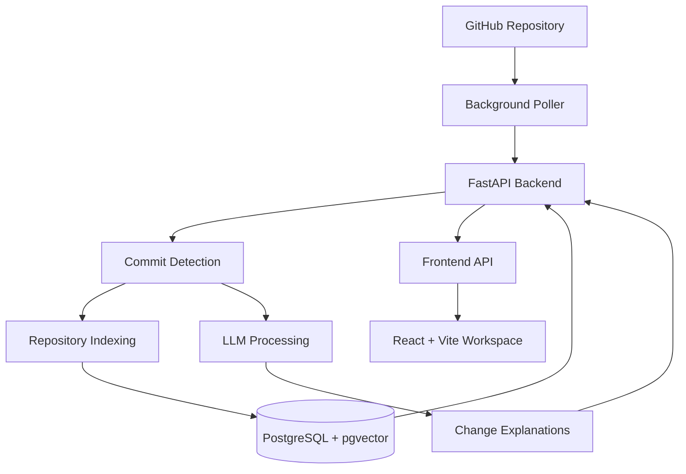

# Catchup 🚀

### Stay up to date with every change in your codebase.

Catchup is an AI-powered GitHub repository monitoring application that automatically detects new commits and generates explanations to help developers understand code changes.

Instead of manually reviewing repository activity, Catchup provides a centralized workspace for tracking commits and understanding what changed.

**[🌐 Live Demo](https://catchup-flax-three.vercel.app/)**

---

## ✨ Features

* **Automatic Commit Detection** — Monitors configured GitHub repositories for new commits.
* **AI-Powered Explanations** — Generates explanations of code changes using an LLM.
* **Repository Monitoring** — Track activity across monitored repositories from one workspace.
* **Persistent Repository Indexing** — Stores indexed repository content and related data for processing.
* **Commit Activity History** — View detected repository activity in a centralized interface.
* **Background Processing** — Uses background polling and processing to keep repository activity updated.
* **Full-Stack Deployment** — Deployed frontend, backend, and database infrastructure.

## 🛠️ Tech Stack

| Component              | Technology      |
| ---------------------- | --------------- |
| Frontend               | React.js, Vite  |
| Backend                | Python, FastAPI |
| Database               | PostgreSQL      |
| Vector Storage         | pgvector        |
| Repository Integration | GitHub API      |
| AI Integration         | LLM APIs        |
| Frontend Hosting       | Vercel          |
| Backend Hosting        | Render          |
| Database Hosting       | Neon PostgreSQL |

## 🏗️ Architecture



## ⚙️ How It Works

1. **Connect a repository:** Configure the GitHub repository you want to monitor.
2. **Detect changes:** Background polling checks for new commits.
3. **Process activity:** The backend processes detected changes and maintains repository data.
4. **Generate explanations:** The LLM helps explain code changes.
5. **Review updates:** The workspace displays repository activity and generated explanations.

## 🚀 Live Demo

**Frontend:** https://catchup-flax-three.vercel.app/
**Backend:** https://catchup-7tzq.onrender.com/

The backend URL exposes the deployed service. Available API endpoints depend on the backend configuration.

## 💻 Local Development

### Prerequisites

* Python
* Node.js and npm
* PostgreSQL with pgvector support, or a compatible configured database
* A GitHub token if required by the repository integration
* An LLM API key for AI-powered explanations

### 1. Clone the repository

```bash
git clone https://github.com/Midhat-hub/catchup.git
cd catchup
```

### 2. Configure the backend

Create the backend environment file using the project's current configuration and environment-variable definitions.

Configure the database connection, GitHub credentials, and LLM API credentials as required.

Install backend dependencies using the dependency file provided by the project, then start the FastAPI application using its configured entry point.

### 3. Configure the frontend

```bash
cd frontend
npm install
npm run dev
```

Open the local URL printed by Vite.

> Check the current backend and frontend configuration files for exact environment-variable names, startup commands, and API URLs before running the application.

## 🔐 Security Considerations

* Keep API keys and credentials in environment variables.
* Never commit `.env` files or real credentials.
* Use appropriately scoped GitHub tokens.
* Review repository content handling before indexing private code or sending code to an external LLM provider.

## 🧪 Testing

Run the backend and frontend test suites using the commands defined in the project configuration.

Before submitting changes, verify that commit detection, repository activity, AI explanations, and the production build continue to work.

## 🗺️ Roadmap

* Improve repository indexing and processing performance.
* Improve the reliability of background commit detection.
* Refine AI-generated explanations.
* Enhance workspace usability and activity visibility.
* Expand automated test coverage.

## 👩‍💻 Author

**Midhat**

* GitHub: [Midhat-hub](https://github.com/Midhat-hub)
* Live Project: [Catchup](https://catchup-flax-three.vercel.app/)

---

Built to make understanding code changes easier.
