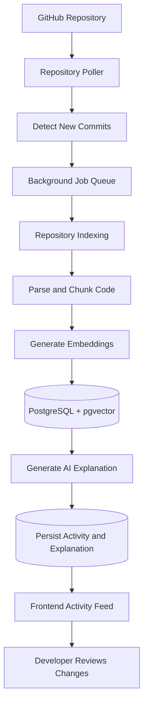

<div align="center">

# ⚡ Catchup

### Stay up to date with every change in your codebase.

**Catchup automatically monitors GitHub repositories, detects new commits, and generates AI-powered explanations of code changes—so you can understand what changed without manually digging through every commit.**

<br />

[🚀 Live Demo](https://catchup-flax-three.vercel.app/) · [💻 Source Code](https://github.com/Midhat-hub/catchup)

<br />


</div>

---

## 💡 The Idea Behind Catchup

Understanding how a codebase evolves can be time-consuming.

When working on a team project, contributing to an unfamiliar repository, or returning to a project after a break, developers often need to inspect commits, compare changes, and trace the evolution of the codebase to understand what happened.

**Catchup simplifies this process by bringing repository activity and AI-generated change explanations into one place.**

Connect a GitHub repository, let Catchup track new commits, and review the changes through an activity feed with explanations generated from the code.

The goal is simple: **less time figuring out what changed, more time building.**

## ✨ Features

### 🔄 Automatic Commit Detection

Catchup periodically checks monitored repositories for new commits, allowing repository activity to appear without manually entering commit SHAs.

### 🤖 AI-Powered Code Explanations

Generate explanations of code changes to help developers understand what a commit modifies and how the changes relate to the surrounding code.

### 🔍 Commit Change Tracking

Track repository progress through commit history and compare changes between revisions.

### 🧠 Code Indexing and Embeddings

Parse repository files into smaller chunks, generate embeddings, and store indexed code for use in the analysis workflow.

### 📚 Repository Activity History

View detected repository activity and previously generated explanations in a centralized interface.

### ⚙️ Background Processing

Use background polling and job processing to discover commits, process repository changes, and generate explanations without requiring every operation to happen inside a frontend request.

### 🌐 Live Deployment

Access the deployed application through a browser without setting up the project locally.

---

## 🛠️ Tech Stack

| Layer                  | Technologies                   | Purpose                                          |
| ---------------------- | ------------------------------ | ------------------------------------------------ |
| Frontend               | React.js, Vite                 | Interactive user interface                       |
| Backend                | Python, FastAPI                | API endpoints and application logic              |
| Database               | Neon PostgreSQL                | Persistent application data                      |
| Vector Storage         | PostgreSQL, pgvector           | Store and retrieve code embeddings               |
| Repository Integration | GitHub API                     | Access repository information and commit history |
| AI                     | LLM integration and embeddings | Explain code changes and support code analysis   |
| Frontend Hosting       | Vercel                         | Deploy the web application                       |
| Backend Hosting        | Render                         | Host the API and background processing           |
| Database Hosting       | Neon                           | Managed PostgreSQL database                      |

---

## 🔄 How It Works

Catchup combines repository monitoring, code indexing, background jobs, and AI-generated explanations into a single workflow.



### Workflow Breakdown

**1. Connect a repository**

Catchup works with GitHub repository information to identify the codebase and its commit history.

**2. Monitor repository activity**

A background polling process checks the repository for new commits.

**3. Discover and queue changes**

New commits are identified and passed through the background job-processing workflow.

**4. Index the code**

Repository files are parsed into chunks and converted into embeddings for storage and retrieval.

**5. Generate explanations**

The AI workflow processes the relevant code changes and generates an explanation.

**6. Display the results**

The resulting activity and explanation are persisted and made available through the Catchup interface.

---

## 🏗️ Architecture

Catchup separates its user interface, API, background processing, and persistent storage.

```text
                    ┌────────────────────────┐
                    │      GitHub API        │
                    └───────────┬────────────┘
                                │
                                ▼
┌─────────────────┐    ┌─────────────────────┐
│   React + Vite  │◄──►│    FastAPI Backend   │
│    Frontend     │    │                     │
└─────────────────┘    │  Repository Poller   │
                       │  Background Workers │
                       │  Code Indexing       │
                       │  AI Explanations     │
                       └──────────┬──────────┘
                                  │
                                  ▼
                       ┌─────────────────────┐
                       │   Neon PostgreSQL   │
                       │                     │
                       │  Persistent Data    │
                       │  Code Embeddings    │
                       │     pgvector        │
                       └─────────────────────┘
```

### Why This Architecture?

* **Separation of concerns:** The frontend, API, and background processing have distinct responsibilities.
* **Persistent state:** Repository activity and processing state can be stored across application restarts.
* **Asynchronous processing:** Commit discovery and explanation generation can be handled through background jobs.
* **Vector-based retrieval:** Code embeddings provide a foundation for retrieving relevant code during analysis.
* **Independent deployment:** The frontend and backend can be deployed and updated separately.

---

## 🚀 Try the Live Application

**Live application:** [catchup-flax-three.vercel.app](https://catchup-flax-three.vercel.app/)

### Getting Started

1. Open the live application.
2. Follow the available repository setup and mapping workflow.
3. Wait for the repository to finish indexing.
4. Review the repository's activity.
5. Push a new commit to the monitored repository.
6. Allow the background polling process to detect the change.
7. Open Catchup to review the resulting activity and explanation.

*Detection and explanation generation depend on the backend being available, valid configuration, and the relevant GitHub and AI services being accessible.*

---

## 💻 Run Locally

### Prerequisites

Install the following before running Catchup:

* [Node.js](https://nodejs.org/) and npm
* [Python](https://www.python.org/)
* [Git](https://git-scm.com/)
* A PostgreSQL database with the required `pgvector` support
* GitHub API credentials, if required by your usage
* Credentials for the configured AI provider

### 1. Clone the Repository

```bash
git clone https://github.com/Midhat-hub/catchup.git
cd catchup
```

### 2. Set Up the Backend

Open a terminal in the project directory:

```bash
cd backend
python -m venv .venv
```

Activate the virtual environment.

**Windows PowerShell:**

```powershell
.\.venv\Scripts\Activate.ps1
```

**macOS/Linux:**

```bash
source .venv/bin/activate
```

Install the backend dependencies using the dependency file provided in the backend directory.

For a project using `requirements.txt`:

```bash
pip install -r requirements.txt
```

Configure the required environment variables using the names expected by the backend configuration. These will typically include database connection details and the credentials required by the enabled GitHub and AI integrations.

Start the FastAPI application using the entry point configured in the project. If the application is exposed through `app.main`, the command is:

```bash
uvicorn app.main:app --reload
```

The backend will typically be available at:

```text
http://localhost:8000
```

FastAPI's interactive API documentation is available at:

```text
http://localhost:8000/docs
```

### 3. Set Up the Frontend

Open a second terminal:

```bash
cd frontend
npm install
```

Configure the frontend API base URL using the environment variable supported by the project. For local development, point it to the local FastAPI server.

Start the development server:

```bash
npm run dev
```

Open the local URL printed in your terminal, typically:

```text
http://localhost:5173
```

### 4. Configure the Database and Integrations

Before using the complete application, ensure that:

* PostgreSQL is reachable.
* The required database schema and extensions are available.
* The GitHub integration has the necessary access.
* The AI provider credentials are configured.
* The frontend points to the correct backend URL.
* The backend's background polling and worker processes are running.

**Note:** Check the repository's dependency files, configuration, and environment-variable references for the exact setup required by the current implementation.

---

## 🔐 Configuration and Security

Catchup integrates with external services, so credentials and configuration should be handled carefully.

* Store API keys and database credentials in environment variables.
* Never commit `.env` files containing secrets.
* Keep production credentials separate from local development credentials.
* Use the minimum GitHub permissions required for your workflow.
* Avoid logging API keys, database passwords, or other sensitive values.
* Restrict access to the database and production services appropriately.

Example `.env` files should contain placeholders rather than real credentials.

```env
# Illustrative placeholders — use the variable names
# expected by the current backend configuration.

DATABASE_URL=your_postgresql_connection_string
GITHUB_TOKEN=your_github_token
AI_API_KEY=your_ai_provider_api_key
```

The actual variable names depend on the application's configuration and the selected AI provider.

---

## 🧪 Development and Testing

The project includes testing and build-validation workflows for supported components.

For the frontend, run the available test suite:

```bash
npm test
```

Build the frontend for production:

```bash
npm run build
```

Run the backend tests using the project's configured test framework. For a pytest-based setup:

```bash
pytest -v
```

These commands assume the relevant scripts, dependencies, and test configuration are present in the checked-out version.

---

## 🗺️ Roadmap

Potential improvements for future versions include:

* [ ] Email notifications when new commit explanations are ready
* [ ] Faster initial application loading
* [ ] A dedicated Home page with project documentation and onboarding
* [ ] More detailed code-change summaries
* [ ] Improved repository navigation and filtering
* [ ] Additional controls for notification preferences
* [ ] Expanded testing and observability for background processing

*Roadmap items are planned improvements, not claims about currently available functionality.*

---

## 🧠 What I Learned Building Catchup

Catchup has been an opportunity to explore the engineering challenges involved in building and deploying a full-stack application.

Some of the key areas include:

* Integrating a frontend with a production backend API.
* Working with the GitHub API and repository commit history.
* Designing background polling and job-processing workflows.
* Indexing source code and generating embeddings.
* Persisting application state using PostgreSQL and pgvector.
* Integrating AI into a practical developer workflow.
* Debugging deployment, API routing, CORS, and database issues.
* Testing the application across local and production environments.

The project combines backend engineering, data persistence, AI integration, and deployment into one practical system.

---

## 👩‍💻 Author

**Midhat**

B.Tech in Data Science | Full-Stack Development | Backend Engineering | AI Applications

* **GitHub:** [@Midhat-hub](https://github.com/Midhat-hub)
* **Project:** [Catchup Repository](https://github.com/Midhat-hub/catchup)
* **Live Demo:** [Try Catchup](https://catchup-flax-three.vercel.app/)

---

<div align="center">

### Follow the changes. Understand the code. Catch up faster. ⚡

**Built to make understanding codebase changes easier.**

</div>
